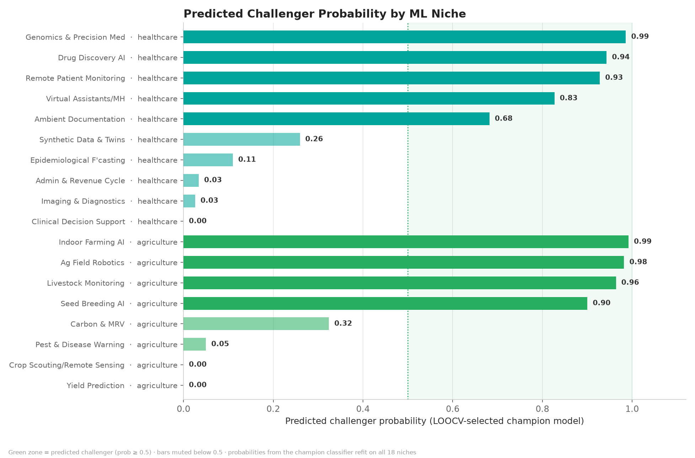
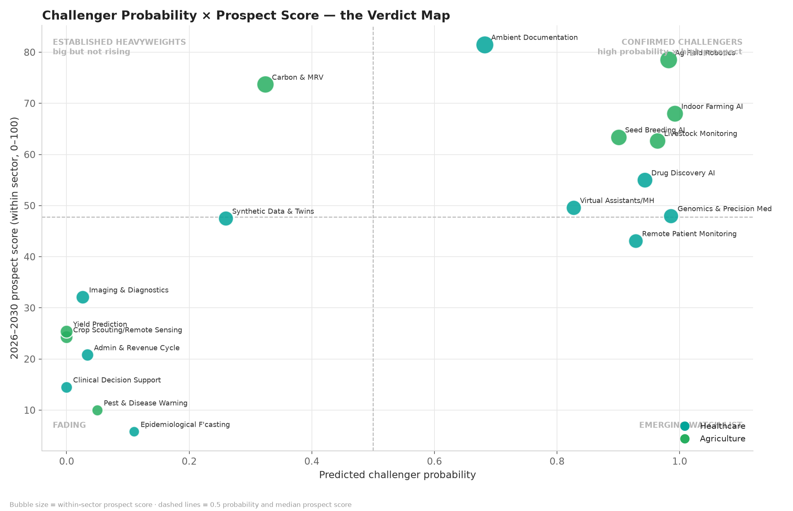

# The NEXT Challenger Niches inside ML

### Healthcare & Agriculture — a supervised challenger-detection model + 2026–2030 prospect ranking

The sister project (*[The NEXT Top Industries for DS/ML](https://github.com/danielosinor123-gif/ds-ml-industry-prospects)*) ranked
**industries**. This one zooms in: inside **Healthcare** and **Agriculture**,
which **ML/DS niches** are the rising challengers — and can a model detect
them *from early signals alone*, before the breakout happens?

- **18 ML niches** (10 healthcare, 8 agriculture) tracked 2015–2025 on
  market size, investment, job postings, ML adoption and patents
- **Supervised classifier:** nine features computed from **2015–2019 only**
  → predicts which niches break out (above-median within-sector share gain
  by 2025). Logistic regression vs random forest, **leave-one-out
  cross-validated**
- **Forecast layer:** the same backtested ensemble (log-linear OLS +
  damped Holt, 90% bootstrap CIs) projects each niche to 2030; prospect
  scores are min-max normalised **within each sector**

---

## TL;DR — Results

**Champion model: Random Forest — LOOCV AUC 0.90** (logistic regression: 0.78), 83% out-of-fold accuracy.

| Model | LOOCV AUC | LOOCV accuracy |
|---|---:|---:|
| **Random Forest** *(champion)* | **0.901** | 83% |
| Logistic Regression | 0.778 | 83% |

**Predicted challengers — Healthcare** (P ≥ 0.5):

| Niche | P(challenger) | 2030 outlook |
|---|---:|---|
| Genomics & Precision Medicine | 0.99 | score 48.0 · +30.9% CAGR |
| Drug Discovery & Development | 0.94 | score 55.0 · +31.1% CAGR |
| Remote Patient Monitoring & Wearables | 0.93 | score 43.1 · +32.3% CAGR |
| Virtual Assistants & Mental-Health AI | 0.83 | score 49.6 · +34.4% CAGR |
| **Ambient Clinical Documentation** | 0.68 | **score 81.5 · +51.0% CAGR** |

**Predicted challengers — Agriculture** (P ≥ 0.5):

| Niche | P(challenger) | 2030 outlook |
|---|---:|---|
| Indoor & Vertical Farming Optimization | 0.99 | score 68.0 · +31.1% CAGR |
| Autonomous Equipment & Field Robotics | 0.98 | score 78.5 · +31.3% CAGR |
| Livestock Monitoring & Health Vision | 0.96 | score 62.7 · +28.4% CAGR |
| ML-Guided Seed Breeding & Gene Editing | 0.90 | score 63.4 · +30.5% CAGR |

**Top overall pick:** *Ambient Clinical Documentation* — the model flags it
as a challenger **and** the forecast layer scores it highest of all 18
niches (81.5/100, +51% CAGR through 2030).

**The instructive miss:** *Carbon & Sustainability Analytics (MRV)* scores
**0.32 probability** despite a strong 2030 outlook (73.7) — because the
niche barely existed in 2015–2019 (it emerged with carbon markets after
2021), and the classifier only sees early-window signals. That's the model
working as designed: probability = *what the early data supports*, score =
*where the future is heading*. Use both axes.




---

## Method

```
18 niches x 2015-2025 panel  ──┬─▶ ensemble forecast 2026-2030   src/forecast.py
                              │     (log-linear OLS + damped Holt,
                              │      backtested weights, bootstrap CIs)
                              │
                              ├─▶ WITHIN-SECTOR prospect scores    src/scoring.py
                              │     (growth 30 · scale 25 · invest 20 · jobs 15 · adoption 10)
                              │
                              └─▶ challenger classifier            src/challenger.py
                                    features: 2015-2019 window ONLY
                                    label: above-median within-sector
                                           share gain 2019 -> 2025
                                    logistic regression vs random forest
                                    leave-one-out CV (18 folds) -> champion
```

**Temporal design (no leakage):** features come strictly from 2015–2019;
the label is the 2019→2025 outcome. The model therefore answers *"which
early-window signals separate niches that went on to break out?"* —
growth acceleration, investment intensity/acceleration, patent velocity,
adoption slope and early share gains.

**Full write-up:** [`outputs/reports/summary_report.md`](outputs/reports/summary_report.md)

---

## Repository structure

```
niche-prospects/
├── main.py                       # end-to-end pipeline (run this)
├── requirements.txt
├── src/
│   ├── data.py                   # 18-niche benchmark-calibrated panel builder
│   ├── forecast.py               # ensemble + logistic adoption models
│   ├── scoring.py                # within-sector composite index
│   ├── challenger.py             # supervised challenger detection (NEW)
│   ├── visuals.py                # 5 charts
│   └── report.py                 # markdown report writer
├── data/niche_panel.csv          # the panel dataset
└── outputs/
    ├── predictions.csv           # challenger probabilities & verdicts
    ├── challenger_features.csv  # early-window model features
    ├── scores.csv / forecasts.csv
    ├── charts/                   # 5 publication-ready charts
    └── reports/summary_report.md
```

## Quickstart

```bash
pip install -r requirements.txt
python main.py                                   # full pipeline
python main.py --horizon 8 --seed 7              # different horizon / seed
python main.py --from-csv data/niche_panel.csv   # real data, same schema
```

## Data honesty

The bundled panel is **benchmark-calibrated synthetic data** — magnitudes
match public estimates (AI in medical imaging / drug discovery / genomics,
ambient-AI scribes, precision agriculture, ag robotics, livestock
monitoring, carbon MRV, etc.), but they are not scraped primary sources.
This matters *more* here than in the sister project: the classifier's AUC
is optimistic because features and labels come from the same generating
process. The pipeline demonstrates the **method**; on a real panel via
`--from-csv`, the same code runs unchanged and the AUC becomes a genuine
performance estimate.

## Limitations

- n = 18 niches → LOOCV AUC is high-variance at this size.
- Label is *relative* (above sector-median share gain) — thresholds change class balance.
- Synthetic calibrated inputs (see above).
- Forecast layer inherits the sister project's caveats: short series, iid bootstrap, fixed adoption ceilings, no shock modelling.
- Niche boundaries overlap (ambient documentation touches admin automation) — some double counting.

## References

- Grand View Research — *AI in Medical Imaging*, *AI in Drug Discovery*, *AI in Genomics*
- CB Insights / PitchBook — ambient-AI scribe funding wave (2023–25)
- MarketsandMarkets / Precedence — *Precision Agriculture*, *Agricultural Robots*, *Livestock Monitoring*
- McKinsey — *The State of AI*; Stanford HAI — *AI Index Report*
- US BLS — *Data Scientists* occupational outlook
- Sister project — *The NEXT Top Industries for DS/ML* (same forecasting engine)

---

## Where to find this project

- **Live showcase (Hugging Face Space):** https://danielaxv3-ds-ml-niche-challengers.static.hf.space
- **GitHub:** https://github.com/danielosinor123-gif/ds-ml-niche-challengers
- **Hugging Face repo:** https://huggingface.co/spaces/danielaxv3/ds-ml-niche-challengers
