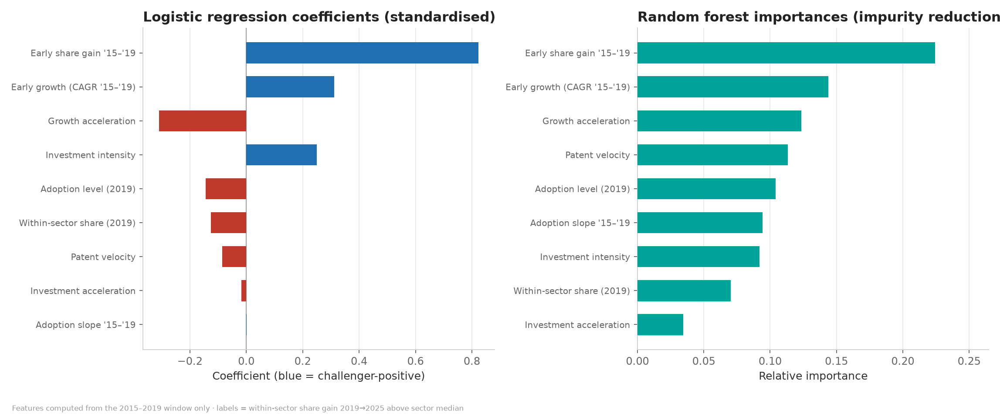
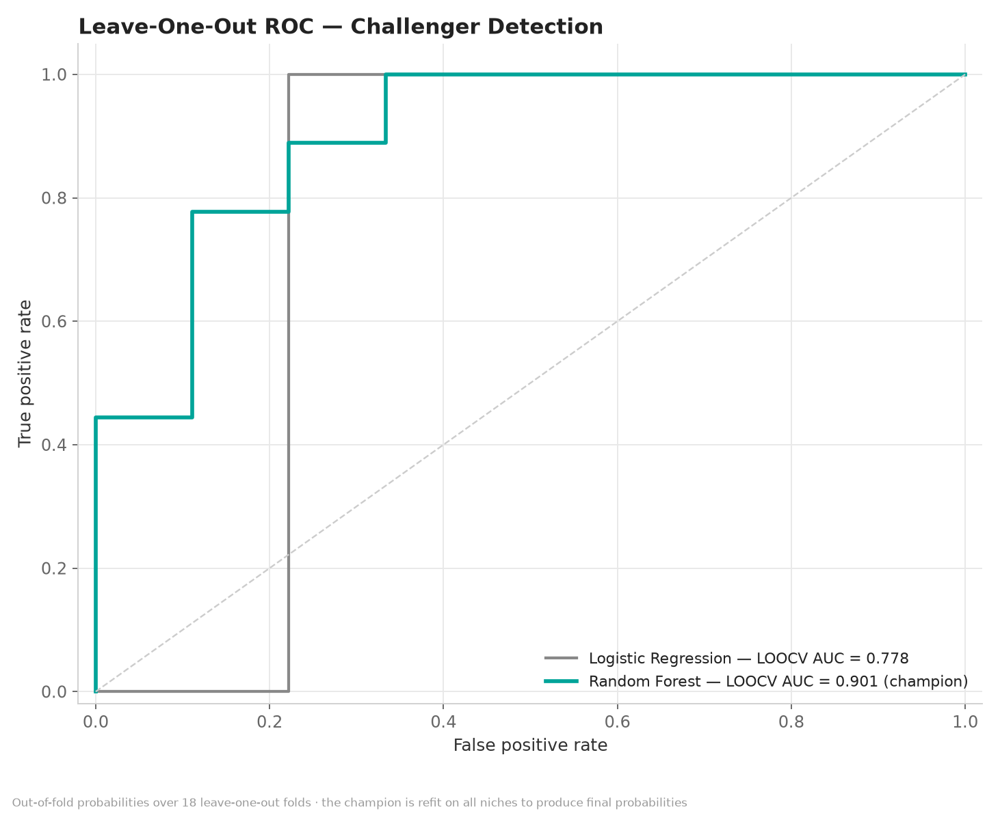
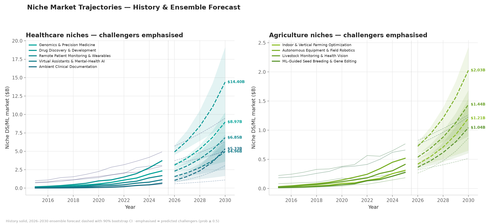

# The NEXT Challenger Niches inside ML
### Healthcare & Agriculture — a supervised challenger-detection model, 2026–2030

*Generated automatically by `main.py` · 18 ML niches (10 healthcare, 8
agriculture) · panel 2015–2025 · forecast
horizon 5 years*

---

## 1. Executive Summary

A supervised classifier reads **only 2015–2019 signals** from each niche and
predicts which niches *break out* (gain within-sector share through 2025).
The champion model — **Random Forest** — reaches a **leave-one-out AUC of
0.90** on held-out niches.

**Predicted challengers in Healthcare:** **Genomics & Precision Medicine** (0.99), **Drug Discovery & Development** (0.94), **Remote Patient Monitoring & Wearables** (0.93), **Virtual Assistants & Mental-Health AI** (0.83), **Ambient Clinical Documentation** (0.68)

**Predicted challengers in Agriculture:** **Indoor & Vertical Farming Optimization** (0.99), **Autonomous Equipment & Field Robotics** (0.98), **Livestock Monitoring & Health Vision** (0.96), **ML-Guided Seed Breeding & Gene Editing** (0.90)

Pairing the classifier with the 2026–2030 ensemble
forecast, the confirmed challengers (high probability **and** high prospect
score) are:

- **Ambient Clinical Documentation** — P(challenger) = 0.68, prospect score 81.5, forecast CAGR +51.0%
- **Autonomous Equipment & Field Robotics** — P(challenger) = 0.98, prospect score 78.5, forecast CAGR +31.3%
- **Indoor & Vertical Farming Optimization** — P(challenger) = 0.99, prospect score 68.0, forecast CAGR +31.1%
- **ML-Guided Seed Breeding & Gene Editing** — P(challenger) = 0.90, prospect score 63.4, forecast CAGR +30.5%
- **Livestock Monitoring & Health Vision** — P(challenger) = 0.96, prospect score 62.7, forecast CAGR +28.4%
- **Drug Discovery & Development** — P(challenger) = 0.94, prospect score 55.0, forecast CAGR +31.1%
- **Virtual Assistants & Mental-Health AI** — P(challenger) = 0.83, prospect score 49.6, forecast CAGR +34.4%
- **Genomics & Precision Medicine** — P(challenger) = 0.99, prospect score 48.0, forecast CAGR +30.9%
- **Remote Patient Monitoring & Wearables** — P(challenger) = 0.93, prospect score 43.1, forecast CAGR +32.3%

**The question this project answers:** *inside Healthcare and Agriculture,
which ML/DS niches are the rising challengers — and can a model detect them
from early signals alone?*

---

## 2. The Niche Pool

| Niche                                   | Sector      | 2025 market | % of sector |
| --------------------------------------- | ----------- | ----------- | ----------- |
| Indoor & Vertical Farming Optimization  | Agriculture | $312M       | 9.1%        |
| Autonomous Equipment & Field Robotics   | Agriculture | $519M       | 15.2%       |
| Livestock Monitoring & Health Vision    | Agriculture | $413M       | 12.1%       |
| ML-Guided Seed Breeding & Gene Editing  | Agriculture | $276M       | 8.1%        |
| Carbon & Sustainability Analytics (MRV) | Agriculture | $184M       | 5.4%        |
| Pest & Disease Early Warning            | Agriculture | $292M       | 8.5%        |
| Remote Sensing & Crop Scouting          | Agriculture | $764M       | 22.4%       |
| Yield Prediction & Farm Analytics       | Agriculture | $659M       | 19.3%       |
| Genomics & Precision Medicine           | Healthcare  | $2.33B      | 10.8%       |
| Drug Discovery & Development            | Healthcare  | $3.71B      | 17.2%       |
| Remote Patient Monitoring & Wearables   | Healthcare  | $1.69B      | 7.8%        |
| Virtual Assistants & Mental-Health AI   | Healthcare  | $1.13B      | 5.2%        |
| Ambient Clinical Documentation          | Healthcare  | $680M       | 3.1%        |
| Synthetic Data & Trial Digital Twins    | Healthcare  | $608M       | 2.8%        |
| Outbreak & Epidemiological Forecasting  | Healthcare  | $509M       | 2.4%        |
| Admin Automation & Revenue Cycle        | Healthcare  | $3.09B      | 14.3%       |
| Medical Imaging & Diagnostics           | Healthcare  | $4.91B      | 22.7%       |
| Clinical Decision Support               | Healthcare  | $2.96B      | 13.7%       |

## 3. Method

**Temporal design (no leakage).** Features are computed from the
2015–2019 window only. The label is the outcome: within-sector market-share
gain from 2019 to 2025, thresholded at the sector median (top half =
challenger). The model therefore answers: *which early-window signals
separate niches that went on to break out?*

**Features (9).** Early growth (log-linear CAGR '15–'19), growth
acceleration (CAGR '17–'19 minus CAGR '15–'17), investment intensity
(invest/market), investment acceleration, patent velocity, 2019 adoption
level, adoption slope, within-sector share (2019), early share gain.

**Models.** L2 logistic regression on standardised features (interpretable)
vs a regularised random forest (500 trees, depth 3). Both evaluated by
**leave-one-out cross-validation** (18 folds); the champion is refit on all
niches to emit final probabilities.

**Forecasting layer.** The same backtested ensemble as the sister industry
project: log-linear OLS growth regression + damped Holt exponential
smoothing, weights ∝ 1/MAPE from a 3-year holdout, 90% mixture-bootstrap
intervals; adoption via logistic S-curves. Prospect scores are min-max
normalised **within each sector**.

## 4. Model Card

| Model                      | LOOCV AUC | LOOCV accuracy @ 0.5 |
| -------------------------- | --------- | -------------------- |
| Logistic Regression        | 0.778     | 83%                  |
| Random Forest *(champion)* | 0.901     | 83%                  |

**Top signals (logistic coefficients, standardised):**

| Feature (2015–2019 signals) | Coef  | Reading                   |
| --------------------------- | ----- | ------------------------- |
| Early share gain '15–'19    | +0.82 | pushes toward challenger  |
| Early growth (CAGR '15–'19) | +0.31 | pushes toward challenger  |
| Growth acceleration         | -0.31 | pushes toward established |
| Investment intensity        | +0.25 | pushes toward challenger  |
| Adoption level (2019)       | -0.14 | pushes toward established |

> **Honest caveat:** the bundled panel is benchmark-calibrated synthetic data,
> so the features and labels come from the same generating process — the AUC
> is optimistic and demonstrates the *method*, not real-world skill. On real
> data the identical pipeline runs via `--from-csv`; expect AUC to fall and
> feature importances to become genuinely informative.

## 5. Predictions — all 18 niches

| Niche                                   | Sector      | P(challenger) | Model verdict         | Actual 2019→2025 | Share gain | Prospect score |
| --------------------------------------- | ----------- | ------------- | --------------------- | ---------------- | ---------- | -------------- |
| Indoor & Vertical Farming Optimization  | Agriculture | 0.99          | Predicted challenger  | ▲ broke out      | +3.9 pp    | 68.0           |
| Autonomous Equipment & Field Robotics   | Agriculture | 0.98          | Predicted challenger  | ▲ broke out      | +5.4 pp    | 78.5           |
| Livestock Monitoring & Health Vision    | Agriculture | 0.96          | Predicted challenger  | ▲ broke out      | +4.0 pp    | 62.7           |
| ML-Guided Seed Breeding & Gene Editing  | Agriculture | 0.90          | Predicted challenger  | ▲ broke out      | +4.0 pp    | 63.4           |
| Carbon & Sustainability Analytics (MRV) | Agriculture | 0.32          | Established / holding | held             | +2.7 pp    | 73.7           |
| Pest & Disease Early Warning            | Agriculture | 0.05          | Established / holding | held             | -4.3 pp    | 10.0           |
| Remote Sensing & Crop Scouting          | Agriculture | 0.00          | Established / holding | held             | -8.2 pp    | 24.3           |
| Yield Prediction & Farm Analytics       | Agriculture | 0.00          | Established / holding | held             | -7.4 pp    | 25.4           |
| Genomics & Precision Medicine           | Healthcare  | 0.99          | Predicted challenger  | ▲ broke out      | +4.0 pp    | 48.0           |
| Drug Discovery & Development            | Healthcare  | 0.94          | Predicted challenger  | ▲ broke out      | +6.9 pp    | 55.0           |
| Remote Patient Monitoring & Wearables   | Healthcare  | 0.93          | Predicted challenger  | ▲ broke out      | +3.2 pp    | 43.1           |
| Virtual Assistants & Mental-Health AI   | Healthcare  | 0.83          | Predicted challenger  | ▲ broke out      | +2.5 pp    | 49.6           |
| Ambient Clinical Documentation          | Healthcare  | 0.68          | Predicted challenger  | ▲ broke out      | +2.3 pp    | 81.5           |
| Synthetic Data & Trial Digital Twins    | Healthcare  | 0.26          | Established / holding | held             | +1.6 pp    | 47.5           |
| Outbreak & Epidemiological Forecasting  | Healthcare  | 0.11          | Established / holding | held             | -0.5 pp    | 5.8            |
| Admin Automation & Revenue Cycle        | Healthcare  | 0.03          | Established / holding | held             | -5.5 pp    | 20.8           |
| Medical Imaging & Diagnostics           | Healthcare  | 0.03          | Established / holding | held             | -6.4 pp    | 32.1           |
| Clinical Decision Support               | Healthcare  | 0.00          | Established / holding | held             | -8.1 pp    | 14.5           |





## 6. Market Forecasts (2026–2030)

| Niche                                   | Sector      | 2025 actual | 2030 forecast | 90% CI             | Implied CAGR |
| --------------------------------------- | ----------- | ----------- | ------------- | ------------------ | ------------ |
| Indoor & Vertical Farming Optimization  | Agriculture | $312M       | $1.21B        | [$652M – $1.54B]   | 31.1%        |
| Autonomous Equipment & Field Robotics   | Agriculture | $519M       | $2.03B        | [$1.02B – $2.43B]  | 31.3%        |
| Livestock Monitoring & Health Vision    | Agriculture | $413M       | $1.44B        | [$897M – $1.69B]   | 28.4%        |
| ML-Guided Seed Breeding & Gene Editing  | Agriculture | $276M       | $1.04B        | [$606M – $1.43B]   | 30.5%        |
| Carbon & Sustainability Analytics (MRV) | Agriculture | $184M       | $863M         | [$397M – $1.15B]   | 36.3%        |
| Pest & Disease Early Warning            | Agriculture | $292M       | $516M         | [$464M – $631M]    | 12.0%        |
| Remote Sensing & Crop Scouting          | Agriculture | $764M       | $1.26B        | [$1.18B – $1.62B]  | 10.6%        |
| Yield Prediction & Farm Analytics       | Agriculture | $659M       | $1.23B        | [$1.02B – $1.39B]  | 13.3%        |
| Genomics & Precision Medicine           | Healthcare  | $2.33B      | $8.97B        | [$4.97B – $10.30B] | 30.9%        |
| Drug Discovery & Development            | Healthcare  | $3.71B      | $14.40B       | [$8.58B – $19.14B] | 31.1%        |
| Remote Patient Monitoring & Wearables   | Healthcare  | $1.69B      | $6.85B        | [$3.61B – $8.94B]  | 32.3%        |
| Virtual Assistants & Mental-Health AI   | Healthcare  | $1.13B      | $4.96B        | [$2.55B – $6.35B]  | 34.4%        |
| Ambient Clinical Documentation          | Healthcare  | $680M       | $5.33B        | [$1.66B – $7.31B]  | 51.0%        |
| Synthetic Data & Trial Digital Twins    | Healthcare  | $608M       | $3.06B        | [$1.61B – $3.68B]  | 38.2%        |
| Outbreak & Epidemiological Forecasting  | Healthcare  | $509M       | $1.10B        | [$821M – $1.45B]   | 16.8%        |
| Admin Automation & Revenue Cycle        | Healthcare  | $3.09B      | $6.30B        | [$4.22B – $8.46B]  | 15.3%        |
| Medical Imaging & Diagnostics           | Healthcare  | $4.91B      | $9.48B        | [$8.22B – $11.83B] | 14.1%        |
| Clinical Decision Support               | Healthcare  | $2.96B      | $4.97B        | [$4.54B – $6.10B]  | 10.9%        |



## 7. Limitations

- **Synthetic calibrated inputs** — the classifier learns the data-generating
  process; treat AUC as an upper bound, and re-run on real panels before
  drawing conclusions.
- **n = 18 niches** — LOOCV is honest but high-variance at this size; the
  confidence interval on AUC is wide.
- **Label is relative** — "above sector-median share gain" defines
  challengers *within* this pool; different thresholds give different
  class balance.
- **Forecast layer** inherits the sister project's caveats: short series,
  iid bootstrap assumption, fixed adoption ceilings, no shock modelling.
- **Niche boundaries overlap** (e.g. ambient documentation touches admin
  automation) — some double counting is unavoidable.

## 8. Reproduce

```bash
pip install -r requirements.txt
python main.py                                  # full pipeline
python main.py --horizon 8 --seed 7             # different horizon / seed
python main.py --from-csv data/niche_panel.csv  # real data, same schema
```

## 9. Calibration References

- Grand View Research — *AI in Medical Imaging*, *AI in Drug Discovery*,
  *AI in Genomics/Precision Medicine* market reports
- CB Insights / PitchBook — ambient-AI scribe funding wave (2023–25)
- McKinsey — *The State of AI* (healthcare function adoption)
- MarketsandMarkets / Precedence — *Precision Agriculture*, *Agricultural
  Robots*, *Livestock Monitoring* market estimates
- Climate-tech MRV market reporting (soil carbon, Scope-3 verification)
- US BLS — *Data Scientists* occupational outlook (jobs calibration)
- Sister project: *The NEXT Top Industries for DS/ML* (same forecasting engine)
